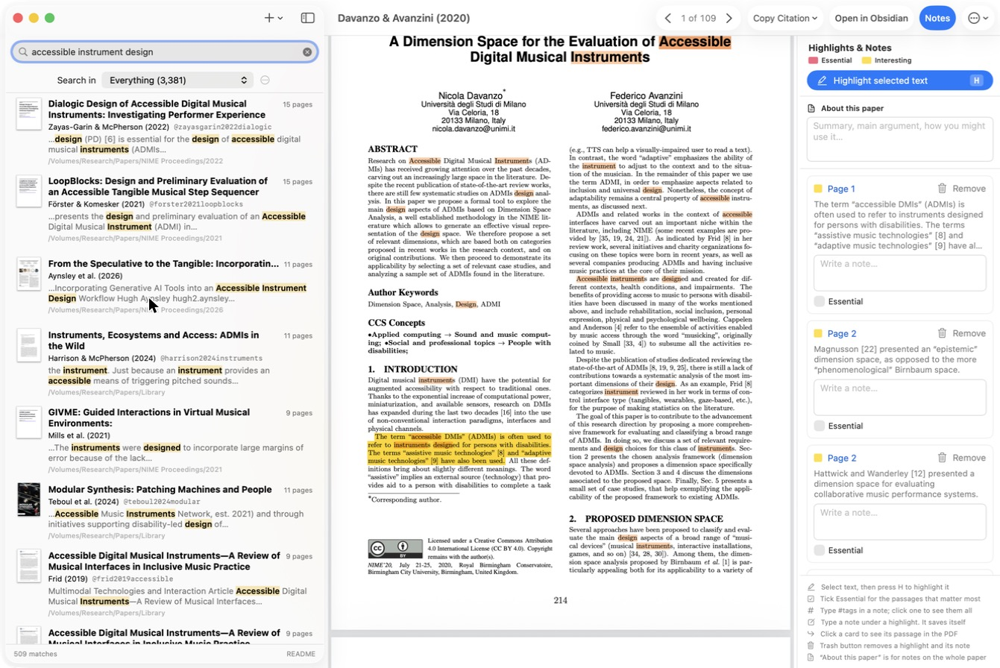
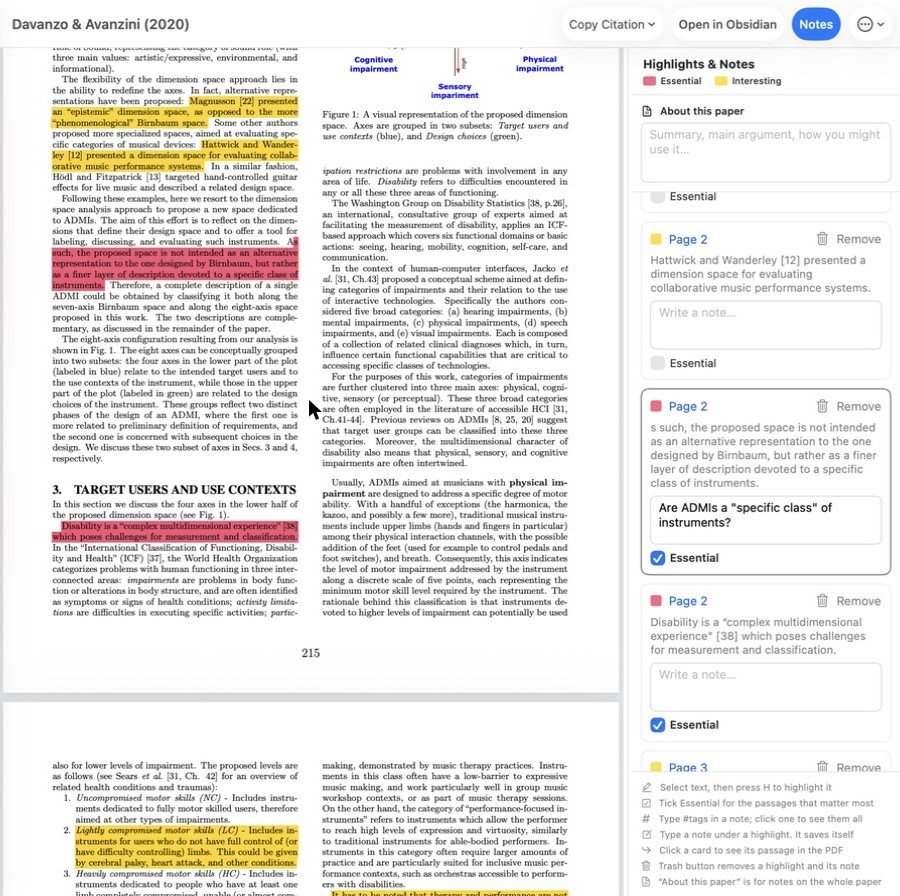
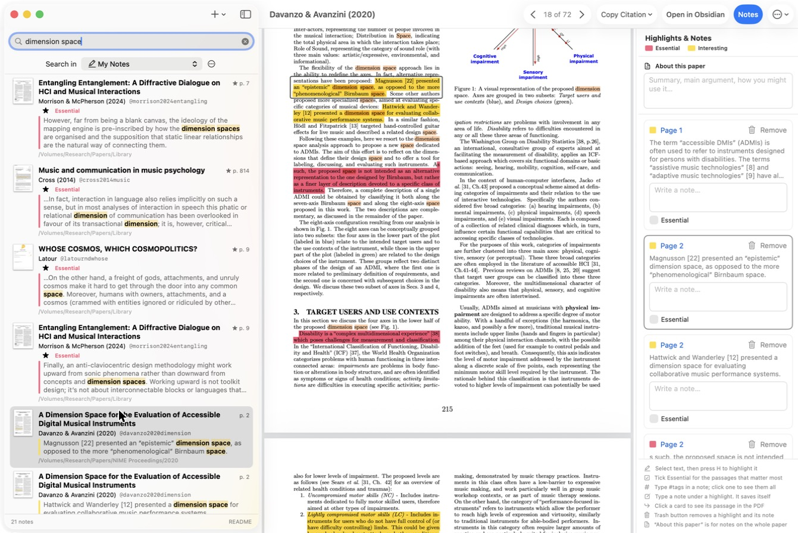
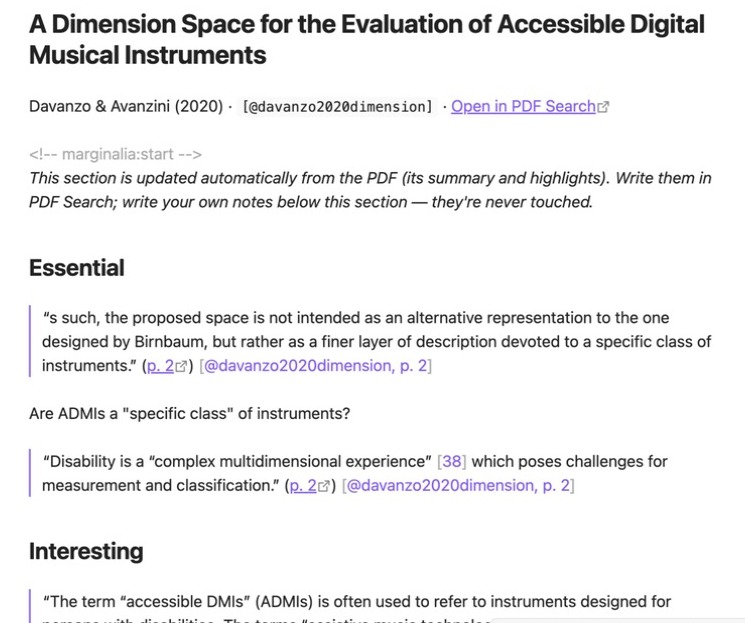
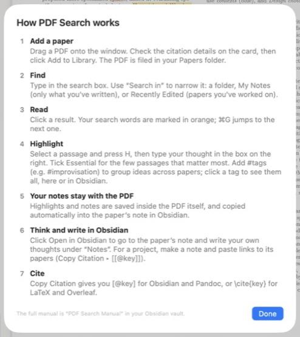

# PDF Search: visual quick start

What PDF Search does, in six pictures. (To install it, see the [TL;DR in the README](README.md#tldr-get-it-running-in-5-minutes).)

---

## 1. Find anything in any PDF

- **Type in the search box** (top left). Every PDF in your Papers folder is searched as you type. Several words are found as that **exact phrase** (capitals don't matter): `accessible instrument design`.
- To find separate words anywhere on the same page, put **commas** between them: `accessible, design`.
- **Results** show each paper's first page, title, author and year, its citation key (`@davanzo2020dimension`), and the matching text.
- **Click a result** to open it. Your search words are marked in **orange**. The arrows at the top (**‹ 1 of 109 ›**, or ⌘G) jump from match to match.
- **Search in** narrows the search: one folder, **My Notes** (only what you've written), **Recently Edited** (papers you've worked on) or **Recently Added**.

---

## 2. Highlight and write notes in the margin

- **Select a passage and press H.** It turns **yellow** (Interesting), and a note card opens in the column on the right. Type your thought; it saves itself.
- **Tick ☐ Essential** on a card for the few passages that matter most. They turn **red**.
- **Click a card** to jump to its passage in the PDF (it's briefly outlined).
- **About this paper** (top of the column) is for notes on the whole paper.
- Add **#tags** to a note (e.g. `#improvisation`) to group ideas across papers. Click a tag to see every note with it.
- Everything is saved **inside the PDF**, as standard PDF comments, so Preview and other apps see it too.

---

## 3. Search only what you've written

- **Search in ▸ My Notes** (⇧⌘F) searches only your highlights, notes and summaries.
- Each result is **one note**: the passage, your comment, and its page. **Essential** notes come first (★).
- Click a result and the PDF opens at that passage.
- Right-click a note ▸ **Copy Quote with Citation** gives you `“the passage” [@key, p. 2]`, ready to paste into a draft.

---

## 4. Every annotated paper gets a note in Obsidian

- For every paper you annotate, PDF Search keeps a Markdown note, `@key.md`: **Essential** passages first, then **Interesting**, each with your notes.
- Each quote has a **p. 2** link that opens the PDF at that page, and a citation `[@key, p. 2]` you can paste into your writing.
- **Open in Obsidian** (toolbar, ⌥⌘O) jumps to a paper's note. Write your own thoughts under **Notes**, and PDF Search never changes them.
- **No Obsidian?** The notes are plain Markdown in `~/Papers/Notes`; any notes app or text editor can open them.

---

## 5. Cite it

![The Copy Citation menu: [@key] for Obsidian/Pandoc, [[@key]] for a link to the paper's note, \cite{key} for LaTeX/Overleaf, or the key](docs/guide/05-copy-citation.jpg)

**Copy Citation** (toolbar) copies, then you paste:
- `[@key]`: a citation in Obsidian or any Markdown + Pandoc document
- `[[@key]]`: a link to the paper's note in Obsidian (e.g. in a project note)
- `\cite{key}`: a citation in LaTeX or Overleaf

All of them use one plain bibliography file, `library.bib`.

---

## 6. Forgot how it works?

Click **README** at the bottom of the results list (or **Help ▸ PDF Search README**, ⌘?) for this one-page reminder, inside the app.

---

**Adding papers:** drag a PDF onto the window. PDF Search finds its DOI, ISBN or title, fetches the citation details, shows them on a card to check, then files the PDF as `Papers/Library/<key>.pdf`. Drag a folder and the details are found in the background.

**Adding book pages:** put photos of pages in `Papers/Book Photos`, one book at a time, with the copyright page for a new book. They become a searchable PDF of the book, in page order. Yellow margin marks beside underlines become highlights. Click **Edit** on a highlight to correct text read from a photo.

More detail: the [README](README.md) and [Developer Notes](dist/Developer%20Notes.md).
