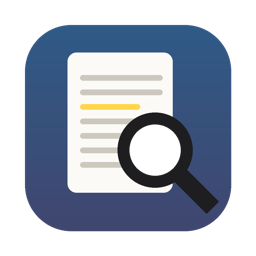

# PDF Search

## TL;DR: get it running in 5 minutes

You need a Mac (macOS 13 or newer). No GitHub account needed.

**1. Install Apple's free tools** (one time only)
- Open **Terminal** (press ⌘ Space, type `Terminal`, press Return).
- Paste this and press Return:
  ```
  xcode-select --install
  ```
- Click **Install** in the window that pops up. Wait until it's done (a few minutes).
  *If it says "already installed", that's fine. Go on.*

**2. Download PDF Search**
- On this page, click the green **Code** button → **Download ZIP**.
- Open your **Downloads** folder and double-click the ZIP to unzip it.
  *If you see a folder called `pdf-search-main` already, Safari unzipped it for you. Go on.*

**3. Build it**
- In Terminal, paste this and press Return:
  ```
  cd ~/Downloads/pdf-search-main && bash build.sh
  ```
- Wait for **Built: /Applications/PDF Search.app**.

**4. Use it**
- Open **PDF Search** from your Applications folder.
- Drag a folder of PDFs onto the window. Wait for indexing to finish.
- Type in the search box. Click a result to read it.
- Select text and press **H** to highlight it and write a note.

That's it. Everything else is below. ⬇️

---

A small, native Mac app for reading and citing research PDFs: full-text search across all of them, notes in the margins, and a plain BibTeX bibliography. A lightweight alternative to DEVONthink and Zotero for people who want one simple tool.



- **Add papers and books in one step.** Drop a PDF on the window: PDF Search finds its DOI (or arXiv ID, ISBN, or title), fetches the citation details from doi.org / Crossref / Open Library, shows them on a card to check, then files the PDF as `~/Papers/Library/<key>.pdf` and adds it to `library.bib`. Books without a PDF: type the ISBN.
- **Search everything.** Every word of every PDF in your `~/Papers` folder, as you type, with snippets and page counts. Prefix matching, `"exact phrases"`, and accents/case ignored. Search one folder or all of them.
- **See them.** Each result shows a thumbnail of the PDF's first page (a book's cover, a paper's first page); books without a PDF show their cover from Open Library.
- **Read.** Click a result and the PDF opens at the first match, with every match marked. ⌘G steps through them, and ⌘F finds within the open PDF.
- **Write in the margins.** Select a passage and press **H**. It's highlighted, and a note box opens in the notes column beside the PDF. Every highlight has a note box, which saves as you type. Tick **Essential** on the few passages that matter most (they turn red-pink; the rest stay yellow). Each highlight has a clear Remove button. An **About this paper** box holds notes on the whole paper. Notes are saved *inside the PDF* as standard comments, so Preview, Acrobat and other apps see them too, and they're searchable.
- **Cite.** PDFs are matched to entries in a plain `library.bib`, so results show real titles and authors. **Copy Citation ▾** copies `[@cascone2000aesthetics]` (Markdown/Pandoc, ⇧⌘C), `[[@cascone2000aesthetics]]` (a link to the paper's note in Obsidian) or `\cite{cascone2000aesthetics}` (LaTeX/Overleaf, ⌥⇧⌘C). Books you don't have as PDFs live in the same bibliography.
- **Projects live in your notes app.** For each thing you're writing, keep a note with `[[@key]]` links to its papers; in Obsidian, backlinks show which projects a paper belongs to.
- **Search your own notes.** **Search in ▸ My Notes** (⇧⌘F) searches only what you've written: highlighted passages, your notes on them, paper summaries, and your own writing in the paper notes. Each note is a result; click one to jump to it in the PDF, or right-click → *Copy Quote with Citation* for `“…” [@key, p. 12]`. Ordinary searches also show any of your notes that match.
- **Pick up where you left off.** **Search in ▸ Recently Edited** (⇧⌘E) lists the papers you've highlighted or written notes in, newest first.
- **Simple toolbar.** Just **Copy Citation**, **Open in Obsidian**, **Notes** and **•••**, plus ‹ › while searching. A **README** link under the results (or Help ▸ PDF Search README, ⌘?) explains the workflow on one page. Drag the dividers to resize the results and notes columns.
- **Notes that turn into writing.** For every PDF you annotate, PDF Search keeps a Markdown note (`@key.md`) with each quote (Essential passages first), a page-cited reference (`[@key, p. 12]`), a link back to that page, and your note. Write your own thoughts below; they're never overwritten.

**Portable.** File paths in `library.bib` and the notes are relative to the Papers folder, so the whole library can move to another Mac or an external drive.

**Obsidian is optional.** If you have a folder called `Obsidian Vault` in your home folder, `library.bib` and the paper notes (`Literature/`) go there. Otherwise they go in `~/Papers` (`library.bib`, `Notes/`). You can open them with any text editor or notes app, and change all of this in **Settings (⌘,)**.

It's one Swift file (SwiftUI + PDFKit + SQLite full-text search) with no dependencies. Requires macOS 13 or later.

## Build it

1. Install Apple's command line tools (once). In Terminal:
   ```
   xcode-select --install
   ```
2. Get the code: either `git clone https://github.com/seth-thorn/pdf-search.git`, or click **Code → Download ZIP** above and unzip it.
3. Build it. In Terminal, go into the folder and run the build script:
   ```
   cd pdf-search          # or: cd ~/Downloads/pdf-search-main
   bash build.sh
   ```
   The app is built into `/Applications/PDF Search.app` (or `~/Applications` if you can't write to `/Applications`). The build also prints a short self-test.

Because you build it yourself, macOS doesn't show the "unverified developer" warning.

## Set up your papers

```
~/Papers/
├── Library/        ← your own papers, ideally named by citation key (cascone2000aesthetics.pdf)
└── …               ← any other folders of PDFs (conference proceedings, course readings…)
```

PDF Search indexes `~/Papers` automatically. Each folder inside it can be searched on its own with the "Search in" menu. You can also drag any other folder into the window.

**Citation keys** are last name + year + the first meaningful word of the title, all lowercase: `cascone2000aesthetics`, `collins2006handmade`. If two items would get the same key, the second gets a letter (`…b`).

**Adding papers:** drag a PDF onto the window (or **+ → Add Paper**, ⌘O), check the card, press **Add to Library**. **+ → Add Book or Chapter** (⇧⌘O) looks up an ISBN. Right-click a PDF without details → **Look Up Citation Details…**. To make a folder searchable without adding it to your bibliography: **+ → Add Folder to Search…**.

**Coming from Zotero?** [`tools/import_zotero.py`](tools/) copies your Zotero library into `~/Papers/Library` and writes `library.bib` with fresh keys. It also writes the highlights you made in Zotero's reader into the PDFs. Zotero itself is only read, never changed. See [tools/README.md](tools/README.md).

## Everyday use

| Keys | Action |
|---|---|
| type in the search box | search everything (or the folder chosen in "Search in") |
| ⌘F | find inside the open PDF |
| ⇧⌘F | search only your notes (My Notes) |
| ⇧⌘E | papers you've recently highlighted or annotated |
| ⌘G / ⇧⌘G | next / previous match |
| H | highlight the selected text (a note box opens beside it), also ⌃⌘H |
| ⇧⌘C / ⌥⇧⌘C | copy `[@key]` / `\cite{key}` for the open paper |
| ⌘O / ⇧⌘O | add a paper (PDF) / add a book or chapter (ISBN) |
| ⌘R | rescan folders |
| ⌘0 | zoom to fit |
| ⌥⌘O | open the paper's Markdown note (in Obsidian if you use it; created if needed) |
| ⌘, | settings: papers folder, `library.bib` location, notes folder |

More detail is in **[PDF Search Guide.pdf](dist/PDF%20Search%20Guide.pdf)**. To try it quickly, drag the `test-pdfs` folder in and search for `glitch`.

## Writing with it

- **Markdown (Obsidian, iA Writer, any editor) + Pandoc:** cite with `[@key]`, then export with `pandoc paper.md --citeproc --bibliography ~/Papers/library.bib -o paper.pdf` (or `.docx`). Add `--csl apa.csl` for a specific style.
- **LaTeX / Overleaf:** upload `library.bib` and cite with `\cite{key}`.
- The `@key.md` paper notes already contain your quotes with page-cited references, ready to paste into a draft.

## Repository layout

| Path | What |
|---|---|
| `PDFSearch.swift` | the whole app |
| `Info.plist`, `AppIcon.icns` | app bundle metadata and icon |
| `build.sh`, `Build PDF Search.command` | build and install the app |
| `make-package.sh` | makes a shareable `.dmg` (universal app + guide + source) on your Desktop |
| `tools/` | one-time Zotero import |
| `dist/` | the guide PDF, developer notes and read-me used by the `.dmg` |
| `test-pdfs/` | three tiny PDFs for testing |

How it works inside, and ideas for extending it: **[Developer Notes](dist/Developer%20Notes.md)**.

## Credits

Made by Seth Thorn, built with Claude. MIT licensed (see [LICENSE](LICENSE)).
